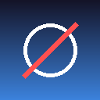

# No Swiftness FOV

removes only the field of view change that comes from the swiftness effect.

client side fabric mod. minecraft 1.21.11, 26.1 and 26.2.

sprinting, flying, bows and every other fov change stay as they are. the effect itself still makes you faster.

## credits

the idea for this mod comes from Truefuly, who made the first version of it. this version is a new rewrite by wysss.

## download

| jar | minecraft |
|---|---|
| `no-swiftness-fov-mc1.21.11-2.0.0.jar` | 1.21.11 |
| `no-swiftness-fov-mc26.1-26.2-2.0.0.jar` | 26.1 to 26.2 |

on the releases page. fabric loader 0.16 or newer.

## how it works

the field of view is calculated from your movement speed. the mod calculates that speed again without the modifier of the swiftness effect and the rest of the game code stays untouched. it works for every swiftness level.

all rights reserved. made by wysss.
